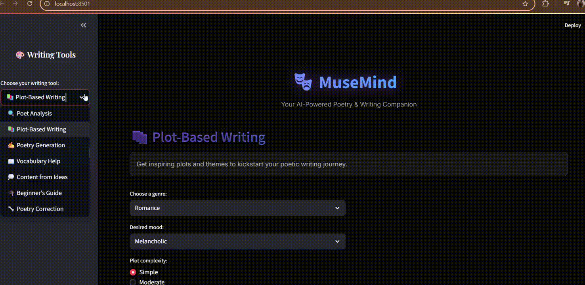

# MuseMind.AI 🎭✨

**Your Creative Multi-Agent Writing Companion - Where AI Meets Artistry**

> *"In every word lies a universe waiting to be discovered. MuseMind.AI doesn't just write—it dreams, crafts, and transforms thoughts into timeless art."*

[](https://www.python.org/)
[](https://langchain.readthedocs.io/)
[](https://opensource.org/licenses/MIT)
[]([https://github.com/shivi5906/musemind.ai](https://github.com/shivi5906/musemind.ai))

---



## 🌟 What is MuseMind.AI?

MuseMind.AI is a sophisticated multi-agent writing assistant that harnesses the power of specialized AI agents to elevate your creative writing experience. Built with Python and LangChain, it combines traditional literary craftsmanship with cutting-edge AI technology to help writers, poets, and storytellers create compelling content.

Whether you're crafting the next great novel, composing heartfelt poetry, or transforming prose into the style of literary masters, MuseMind.AI is your intelligent creative partner.

---

## 🎪 Meet Your Creative Agents

### 🎨 **VerseCraft Agent**
The master poet of the ensemble. Generates original verses with sophisticated corpus-based creativity and semantic control. Features optional RAG-enabled knowledge retrieval for contextually rich poetry creation.

### 📚 **PlotWeaver Agent**
Your storytelling architect. Expertly crafts compelling storylines, develops multi-dimensional characters, and structures dramatic scenes that captivate readers from beginning to end.

### 🎭 **MuseMorph Agent**
The literary shapeshifter. Transforms your writing into the distinctive styles of famous poets and authors—from Shakespeare's eloquence to Hemingway's brevity, from Dickinson's introspection to Kerouac's spontaneity.

### ✨ **LexiFix Agent**
The perfectionist's companion. Polishes your work with meticulous grammar correction, rhythm adjustment, and stylistic enhancement while preserving your unique voice.

### 🔍 **PoetAnalysis Agent**
The literary scholar. Provides deep analysis of poetic works, dissecting style, symbolism, meter, and thematic elements to help you understand and improve your craft.

---

## 📁 Project Structure

```
MuseMind.AI/
│
├── agents/
│   ├── verse_craft_agent.py
│   ├── plot_weaver_agent.py
│   ├── muse_morph_agent.py
│   ├── lexi_fix_agent.py
│   └── poet_analysis_agent.py
│
│
├── data/
│   ├── corpus/
│   │   ├── poetry_corpus.txt
│   │   └── literature_styles.json
│   └── embeddings/
│
├── config/
│   ├── __init__.py
│   └── settings.py
│
├── ui/
│   ├── __init__.py
│   └── streamlit_app.py
│
├── tests/
│   ├── __init__.py
│   ├── test_agents.py
│   └── test_integration.py
│
├── examples/
│   ├── poetry_generation.py
│   ├── story_creation.py
│   └── style_transformation.py
│
├── requirements.txt
├── .env.example
├── .gitignore
├── setup.py
├── LICENSE
└── README.md
```

---

## 🚀 Installation & Setup

### Prerequisites
- Python 3.8 or higher
- pip package manager
- Git

### Quick Start

1. **Clone the repository**
```bash
git clone https://github.com/shivi5906/musemind.ai
cd musemind.ai
```

2. **Create a virtual environment**
```bash
python -m venv musemind_env
source musemind_env/bin/activate  # On Windows: musemind_env\Scripts\activate
```

3. **Install dependencies**
```bash
pip install -r requirements.txt
```


create the `.env` file with your API keys:
```env
GOOGLE_API_KEY=your_google_generative_ai_api_key_here
TAVILY_API_KEY=your_tavily_api_key_here
```

5. **Initialize the system**
```bash
python setup.py install
```

### Getting API Keys

- **Google AI API Key**: Visit [Google AI Studio](https://makersuite.google.com/app/apikey)
- **Tavily API Key**: Sign up at [Tavily](https://tavily.com/) for web search capabilities

---

## 🛠️ Tech Stack

- **🐍 Python 3.8+**: Core programming language
- **🦜 LangChain**: Agent orchestration and LLM integration
- **🧠 Google Generative AI**: Primary language model (Gemini)
- **🔍 FAISS**: Vector similarity search for RAG
- **🌐 Tavily API**: Real-time web search and information retrieval
- **📊 Streamlit**: Interactive web interface (coming soon)
- **📦 Poetry/pip**: Dependency management

---

## 🎯 Use Cases

### For **Poets & Writers**
- Generate original poetry in various styles and forms
- Analyze and improve existing poems
- Transform prose into different literary styles

### For **Storytellers & Novelists**
- Develop compelling plot structures
- Create complex, multi-dimensional characters
- Generate scene descriptions and dialogue

### For **Educators & Students**
- Teach literary analysis and creative writing
- Demonstrate style differences between authors
- Practice grammar and rhythm in poetry

### For **Content Creators**
- Generate creative content for blogs and social media
- Adapt writing style for different audiences
- Create themed content with literary flair

---

## 🗓️ Roadmap

### Phase 1: Core Foundation
- [x] Multi-agent architecture implementation
- [x] VerseCraft Agent with RAG capabilities
- [x] PlotWeaver Agent for story structure
- [x] MuseMorph Agent for style transformation
- [x] LexiFix Agent for editing and polishing
- [x] PoetAnalysis Agent for literary analysis

### Phase 2: Enhanced Features
- [ ] Streamlit web interface
- [ ] Advanced poetry forms (sonnets, haikus, free verse)
- [ ] Character relationship mapping
- [ ] Multi-language support
- [ ] Export to various formats (PDF, EPUB, etc.)

### Phase 3: Advanced Capabilities
- [ ] Collaborative writing sessions
- [ ] Voice-to-text poetry composition
- [ ] Integration with popular writing tools
- [ ] AI-powered writing workshops
- [ ] Community sharing platform

### Phase 4: Enterprise & API
- [ ] RESTful API development
- [ ] Enterprise dashboard
- [ ] Advanced analytics and insights
- [ ] Custom model fine-tuning
- [ ] Scalable cloud deployment

### Phase 4: future improvements 
feature no 6 . vocabulary help - this feature is under development and will be live in the future for getting help with the vocab
feature no 7 . beginner's help "guide" - this is also under development 
integrating the database - there is plan of integration of sqlite database and it will be done in the future ..

---

## 🤝 Contributing

We welcome contributions from the creative coding community! Here's how you can help:

### Ways to Contribute
- 🐛 **Bug Reports**: Found an issue? Open a GitHub issue
- 💡 **Feature Requests**: Have ideas? Share them in discussions
- 📝 **Documentation**: Help improve our docs and examples
- 🔧 **Code**: Submit pull requests for new features or fixes
- 🎨 **Creative Content**: Add new poetry corpora or style examples

### Development Workflow
1. Fork the repository
2. Create a feature branch: `git checkout -b feature/amazing-feature`
3. Make your changes with tests
4. Commit: `git commit -m 'Add amazing feature'`
5. Push: `git push origin feature/amazing-feature`
6. Open a Pull Request

### Code Guidelines
- Follow PEP 8 style guidelines
- Write comprehensive tests for new features
- Update documentation for any API changes
- Ensure backward compatibility

---

## 📄 License

This project is licensed under the MIT License - see the [LICENSE](LICENSE) file for details.

```
MIT License - Feel free to use, modify, and distribute
Commercial use ✅ | Modification ✅ | Distribution ✅ | Private use ✅
```

---

## ⭐ Star This Repository

If MuseMind.AI has inspired your creativity or helped your writing journey, please consider giving us a star! ⭐

Your support helps us continue developing this project and adding new features for the creative community.

[](https://star-history.com/#shivi5906/musemind.ai&Date)

---

## 🙏 Credits & Acknowledgments

### **Author**
**Shivam Sharma** - *Creator & Lead Developer*
- 💼 [LinkedIn](https://linkedin.com/in/shivam-sharma50931)
- 🐦 [Twitter](https://x.com/btwits_ss31)

### **Special Thanks**
- The LangChain community for their incredible framework
- Google AI for providing powerful generative capabilities
- Tavily for enabling real-time web search integration
- All the poets and authors whose works inspire our AI agents

### **Inspiration**
This project was born from the belief that AI should enhance human creativity, not replace it. MuseMind.AI stands as a testament to the beautiful synergy between technology and artistry.

---

## 💌 Connect & Support

Join our creative community:

- **📧 Email**: shivimails0592006@gmail.com
- **💬 Discord**: [Join our server](https://discord.gg/musemind)
- **📝 Blog**: [Read our latest posts](https://blog.musemind.ai)
- **☕ Support**: [Buy me a coffee](https://buymeacoffee.com/shivamsharma)

---

<div align="center">

**"Every master was once a beginner. Every pro was once an amateur. Every icon was once an unknown."**

*Made with ❤️ and endless cups of coffee by Shivam Sharma*

[⬆ Back to Top](#musemindai-)

</div>
